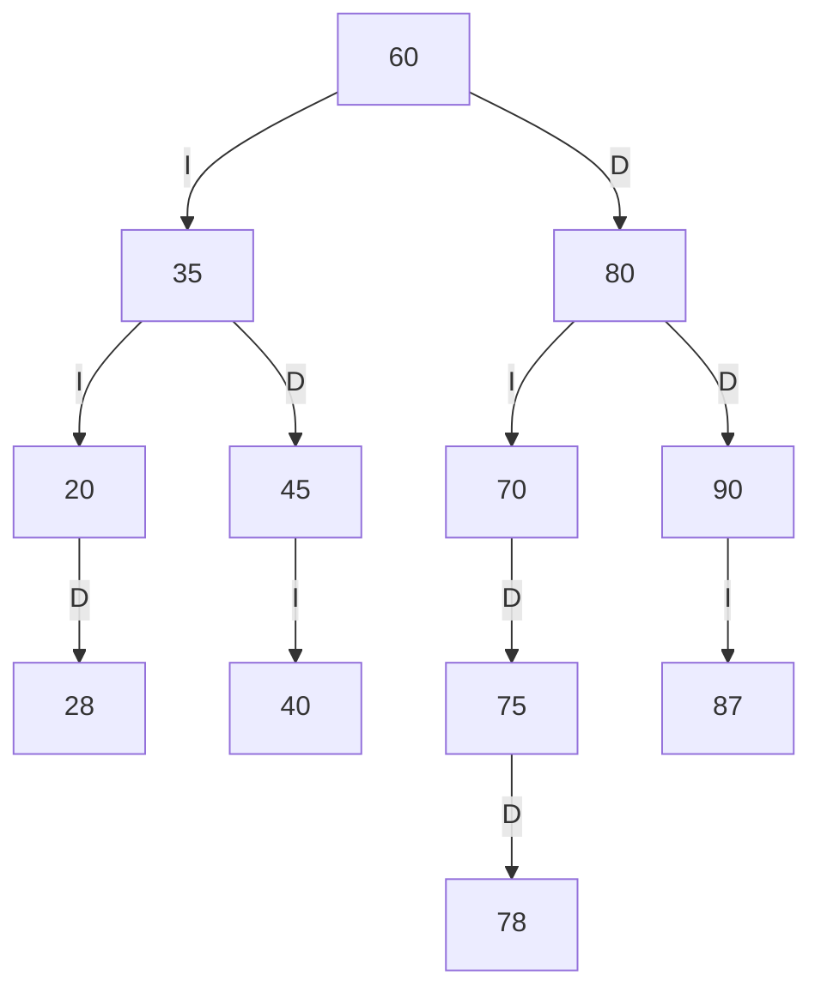
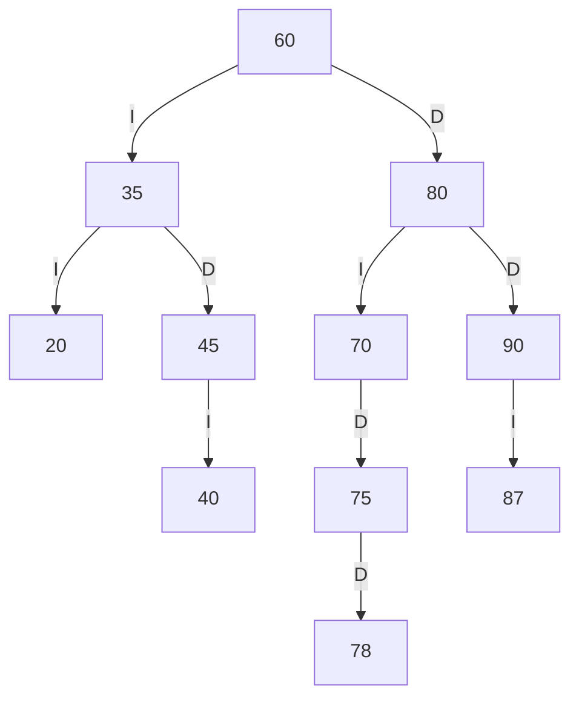
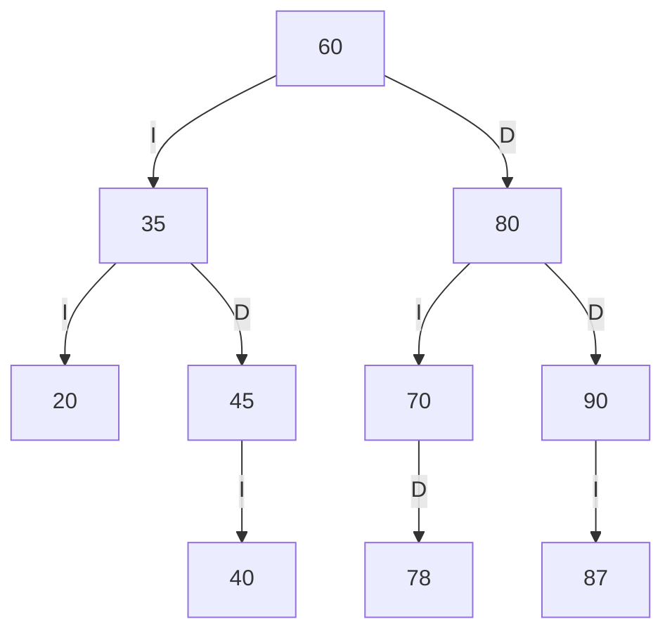
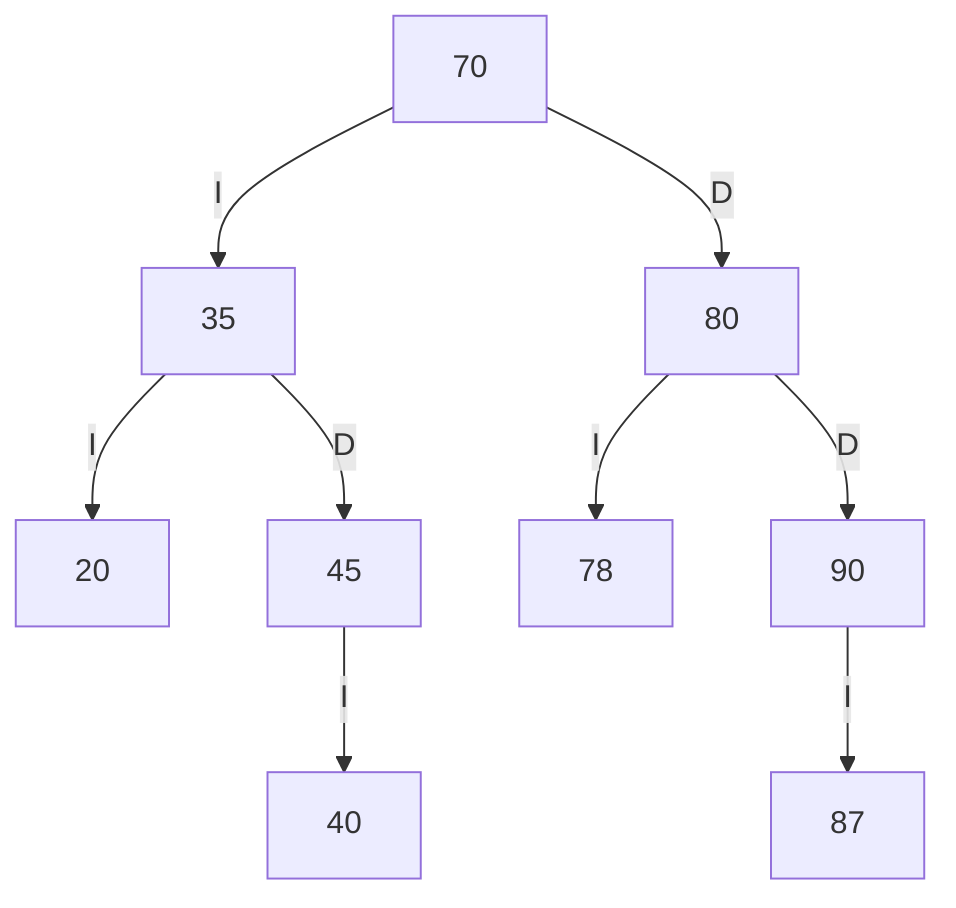

# TRAZAS.md — Resolución a mano y verificación con el programa

Estudiante: Altamirano Segovia Jullisa Brigitte
Cédula: **1805262878**
Estante analizado: **SW-E1** (secuencia inicial: 60, 35, 80, 20, 45, 70, 90, 40, 75)

---

## 1. Tres códigos personales

Con los 4 últimos dígitos de la cédula (abcd) se forman **ab**, **bc** y **cd**.

Cédula 1805262878 → últimos 4 dígitos: **2878**

| Dígitos | Código |
|---------|--------|
| ab      | **28** |
| bc      | **87** |
| cd      | **78** |

Ninguno es 0, no se repiten entre sí y ninguno existía aún en el árbol
(60, 35, 80, 20, 45, 70, 90, 40, 75), por lo que **no** hay que sumarle 1 a ninguno.

## 2. Inserción de la secuencia de SW-E1 y después los 3 códigos personales

Orden de inserción: **60, 35, 80, 20, 45, 70, 90, 40, 75, 28, 87, 78**

- 60 → raíz.
- 35 < 60 → izquierdo de 60. 80 > 60 → derecho de 60.
- 20 < 60, 20 < 35 → izquierdo de 35. 45 < 60, 45 > 35 → derecho de 35.
- 70 > 60, 70 < 80 → izquierdo de 80. 90 > 60, 90 > 80 → derecho de 80.
- 40 < 60, 40 > 35, 40 < 45 → izquierdo de 45. 75 > 60, 75 < 80, 75 > 70 → derecho de 70.
- **28**: 60→35→20, 28 > 20 → **derecho de 20**.
- **87**: 60→80→90, 87 < 90 → **izquierdo de 90**.
- **78**: 60→80→70→75, 78 > 75 → **derecho de 75**.

## 3. ABB final en Mermaid (tras insertar 28, 87, 78)



## 4. Los tres recorridos y la traza del preorden

**Preorden (raíz, izq., der.):** 60 35 20 28 45 40 80 70 75 78 90 87
**Inorden (izq., raíz, der.):** 20 28 35 40 45 60 70 75 78 80 87 90 *(queda ordenado: propiedad ABB)*
**Posorden (izq., der., raíz):** 28 20 40 45 35 78 75 70 87 90 80 60

**Traza del preorden** (formato: `entra X`, `VISITA X`, `null -> regresa`; 2 espacios por nivel):

```
entra 60
VISITA 60
  entra 35
  VISITA 35
    entra 20
    VISITA 20
      null -> regresa (izquierdo)
      entra 28
      VISITA 28
        null -> regresa (izquierdo)
        null -> regresa (derecho)
    entra 45
    VISITA 45
      entra 40
      VISITA 40
        null -> regresa (izquierdo)
        null -> regresa (derecho)
      null -> regresa (derecho)
  entra 80
  VISITA 80
    entra 70
    VISITA 70
      null -> regresa (izquierdo)
      entra 75
      VISITA 75
        null -> regresa (izquierdo)
        entra 78
        VISITA 78
          null -> regresa (izquierdo)
          null -> regresa (derecho)
    entra 90
    VISITA 90
      entra 87
      VISITA 87
        null -> regresa (izquierdo)
        null -> regresa (derecho)
Secuencia PREORDEN: 60 35 20 28 45 40 80 70 75 78 90 87
```

## 5. Tres eliminaciones (hoja, un hijo y dos hijos)

### 5.1 Eliminación de una HOJA: 28

El nodo 28 no tiene hijos: se desconecta directamente y su padre (20) queda con `derecho = null`.



### 5.2 Eliminación de un nodo con UN HIJO: 75

El nodo 75 solo tiene un hijo (78 a la derecha): el padre de 75 (nodo 70) pasa a apuntar
directamente a 78.



### 5.3 Eliminación de un nodo con DOS HIJOS: 60 (raíz)

La raíz 60 tiene dos hijos. Se reemplaza su dato por el **sucesor inorden** (el mínimo del
subárbol derecho = **70**) y luego se elimina 70 de ese subárbol (70 tenía solo un hijo, 78, que
sube en su lugar).



## 6. Salida del programa y comparación

Salida verificada con la ejecución del programa (los recorridos con traza se obtienen desde el
menú de `Main`, opción 11):

| Punto | Resuelto a mano | Salida del programa | ¿Coincide? |
|-------|-----------------|---------------------|------------|
| Preorden tras insertar | 60 35 20 28 45 40 80 70 75 78 90 87 | `Preorden tras insertar: 60 35 20 28 45 40 80 70 75 78 90 87` | ✔ Sí |
| Inorden tras insertar | 20 28 35 40 45 60 70 75 78 80 87 90 | `Inorden tras insertar: 20 28 35 40 45 60 70 75 78 80 87 90` | ✔ Sí |
| Posorden tras insertar | 28 20 40 45 35 78 75 70 87 90 80 60 | `Posorden tras insertar: 28 20 40 45 35 78 75 70 87 90 80 60` | ✔ Sí |
| Traza preorden | (ver sección 4) | Idéntica línea por línea | ✔ Sí |
| Eliminar hoja 28 | preorden sin 28 | `Preorden: 60 35 20 45 40 80 70 75 78 90 87` | ✔ Sí |
| Eliminar un hijo 75 | 78 sube | `Preorden: 60 35 20 45 40 80 70 78 90 87` | ✔ Sí |
| Eliminar dos hijos 60 | sucesor 70 sube | `Preorden: 70 35 20 45 40 80 78 90 87` · `Inorden: 20 35 40 45 70 78 80 87 90` | ✔ Sí |
| caminoBusqueda(42) | [60, 35, 45, 40] | `caminoBusqueda(42) = [60, 35, 45, 40]` | ✔ Sí |
| contarEnRango(40, 75) | 5 (40, 45, 60, 70, 75) | `contarEnRango(40, 75) = 5` | ✔ Sí |
| Insertar 60 repetido | false | `Insertar 60 repetido = false` | ✔ Sí |

Conclusión: la resolución manual coincide con la salida del programa en todos los puntos.
